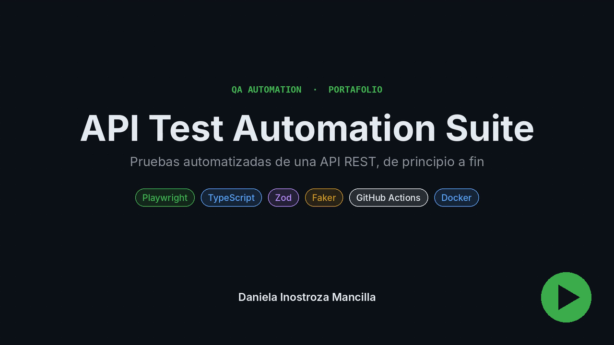
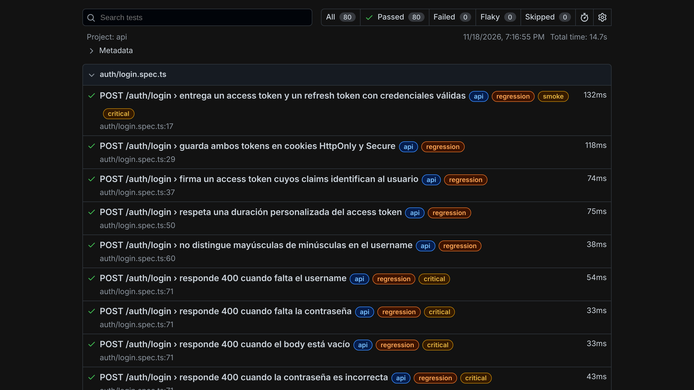

# API Test Automation Suite

[](https://github.com/inostroza-Daniela/api-test-automation-suite/actions/workflows/api-tests.yml)


**[Ver el sitio del proyecto, con video y último reporte](https://inostroza-daniela.github.io/api-test-automation-suite/)**

Suite de pruebas automatizadas para una API REST, construida con Playwright Test y TypeScript. Cubre
operaciones CRUD, paginación, ordenamiento, filtros, contratos de respuesta y autenticación con JWT
sobre los endpoints `users`, `posts` y `auth` de [DummyJSON](https://dummyjson.com), y se ejecuta en
GitHub Actions y Docker.

Elegí DummyJSON en vez de JSONPlaceholder o ReqRes porque no requiere API key y tiene un flujo de
tokens real (access, refresh y sesión por cookies), además de respuestas 400/401/403/404 distintas
contra las cuales probar.

## Video

[](docs/video/video-explicativo.mp4)

Recorrido de 1:17 por el proyecto: qué verifica, la arquitectura, un test por dentro, la suite
corriendo en CI y el defecto de mass assignment que encontró.

## Defectos encontrados

Cada defecto tiene un test marcado con `test.fail()` y el tag `@known-defect`. El test pasa mientras
el defecto existe y falla cuando la API lo corrige; esa es la señal para convertirlo en un test normal.

| Endpoint           | Esperado                                    | Real                                                 |
| ------------------ | ------------------------------------------- | ---------------------------------------------------- |
| `PUT /users/:id`   | La respuesta describe al usuario de la ruta | Un `id` en el body reemplaza el parámetro de la ruta |
| `GET /auth/me`     | `401` con un JWT de firma alterada          | `500`, con el mensaje de error de la librería JWT    |
| `POST /auth/login` | `400` con un `expiresInMins` fuera de rango | `500`                                                |
| `PATCH /posts/:id` | La respuesta mantiene todos los campos      | Falta `views` en la respuesta                        |

El primero es un caso de mass assignment sobre la clave primaria. DummyJSON no persiste las
escrituras, así que aquí solo se ve en la respuesta, pero en un backend real permitiría que una
request modifique un registro distinto al de la URL.

## Stack

- **Playwright Test** como runner y cliente HTTP (`APIRequestContext`, sin navegadores)
- **TypeScript** en modo estricto
- **Zod** para validar los contratos de respuesta
- **Faker** para los datos de prueba
- **ESLint** (typescript-eslint, eslint-plugin-playwright) y **Prettier**
- **GitHub Actions** y **Docker**

## Ejecución

Requiere Node.js 22.13 o superior (`.nvmrc` fija la versión 24).

```bash
npm ci
npm test
```

| Script                  | Descripción                                      |
| ----------------------- | ------------------------------------------------ |
| `npm test`              | Suite completa                                   |
| `npm run test:smoke`    | Tests `@smoke`                                   |
| `npm run test:critical` | Tests `@critical`                                |
| `npm run test:local`    | Suite completa contra un DummyJSON autohospedado |
| `npm run report`        | Abre el último reporte HTML                      |
| `npm run check`         | Lint, tipos y formato                            |

Los tags funcionan con cualquier filtro de Playwright, por ejemplo
`npx playwright test --grep @critical --grep-invert @known-defect`.

### Configuración

| Variable                          | Por defecto  | Descripción                                                            |
| --------------------------------- | ------------ | ---------------------------------------------------------------------- |
| `TEST_ENV`                        | `production` | `production` (https://dummyjson.com) o `local` (http://localhost:8888) |
| `BASE_URL`                        | —            | Reemplaza la URL del ambiente seleccionado                             |
| `TEST_USERNAME` / `TEST_PASSWORD` | —            | Credenciales fijas; si no se definen, se obtienen desde `/users`       |
| `FAKER_SEED`                      | aleatoria    | Semilla de los datos generados, para reproducir una ejecución fallida  |

Los valores también se pueden definir en un archivo `.env` (ver `.env.example`).

### Docker

```bash
docker compose run --rm api-tests
docker compose run --rm api-tests --grep @smoke
```

Los reportes quedan en `playwright-report/` y `test-results/` del host. En Linux, crea ambas carpetas
antes de la primera ejecución para que no queden con dueño root. Sin Compose:

```bash
docker build --tag api-test-automation-suite .
docker run --rm api-test-automation-suite --grep @smoke
```

La imagen se ejecuta con el usuario sin privilegios `node`.

## Reportes



`npm run report` abre el reporte HTML. Cada test muestra sus tags, la anotación del defecto cuando
corresponde y la semilla de Faker que usó. Cuando un test falla, se adjuntan todas sus requests y
respuestas en `api-exchanges.json`, con contraseñas, tokens, cookies y campos similares ocultos. El
reporte JUnit en XML queda en `test-results/junit.xml`.

En CI, ambos reportes se suben como artifacts y se conservan 14 días.

## Estructura

```
config/environments.ts   Resolución y validación de ambientes
fixtures/api.ts          Fixtures: cliente, servicios, credenciales, sesión y semilla de Faker
schemas/                 Contratos Zod de users, posts, auth y errores
services/                Una clase por recurso, el único lugar que conoce los endpoints
tests/auth/              Login, claims del token, cookies, sesión y refresh
tests/posts/             Listado, filtros, búsqueda, creación, actualización y eliminación
tests/users/             Listado, paginación, ordenamiento, creación, actualización y eliminación
utils/api-client.ts      Cliente HTTP con reintentos (429 y cortes de conexión) e historial
utils/assertions.ts      Aserciones de status, schema, paginación, orden y cookies
utils/test-data.ts       Factories y casos data-driven
```

## Decisiones de diseño

- Los tests pasan por clases de servicio (`users.list()`, `auth.login()`), así que un cambio de
  endpoint o de parámetros se hace en un solo lugar.
- Los schemas ignoran campos desconocidos: un campo nuevo no rompe la suite, uno renombrado o con
  otro tipo sí.
- Las credenciales y la sesión autenticada son fixtures de worker, así que cada worker hace login
  una sola vez.
- Los registros de referencia se eligen al azar desde la API en vez de usar ids fijos. Esto cubre
  más del dataset a costa de variabilidad, que se compensa con la semilla de Faker por test y el
  historial de requests.
- DummyJSON permite 100 requests cada 10 segundos. Ante un `429`, el cliente espera lo que indica
  `Retry-After`, con un límite de reintentos, en vez de agregar pausas fijas.
- Los cortes de conexión transitorios (`ECONNRESET`, timeouts) se reintentan con backoff solo en
  métodos idempotentes (`GET`, `PUT`, `DELETE`). Un `POST` o `PATCH` cortado falla de inmediato,
  porque reintentarlo podría duplicar el efecto.

## Limitaciones de la API

DummyJSON simula las escrituras: `POST`, `PUT`, `PATCH` y `DELETE` devuelven el recurso resultante
sin persistirlo, así que la suite valida esas respuestas y no comprueba que un registro eliminado ya
no exista en una lectura posterior. `POST /users/add` no valida campos, por lo que los campos
obligatorios se prueban en `POST /posts/add` y `POST /auth/login`.

## CI

El workflow se ejecuta con cada push a `main`, en los pull requests, a pedido con un filtro `--grep`
opcional y de lunes a viernes de forma programada. Primero corre las validaciones estáticas y
después, en paralelo, la suite completa contra producción y los smoke tests dentro de la imagen
Docker.

Por la ejecución programada, el badge puede ponerse rojo sin un commit nuevo si DummyJSON cambia sus
datos o corrige alguno de los defectos conocidos. Es intencional: así la suite detecta cambios en la
API.

## Licencia

[MIT](LICENSE) © 2026 Daniela Inostroza Mancilla
